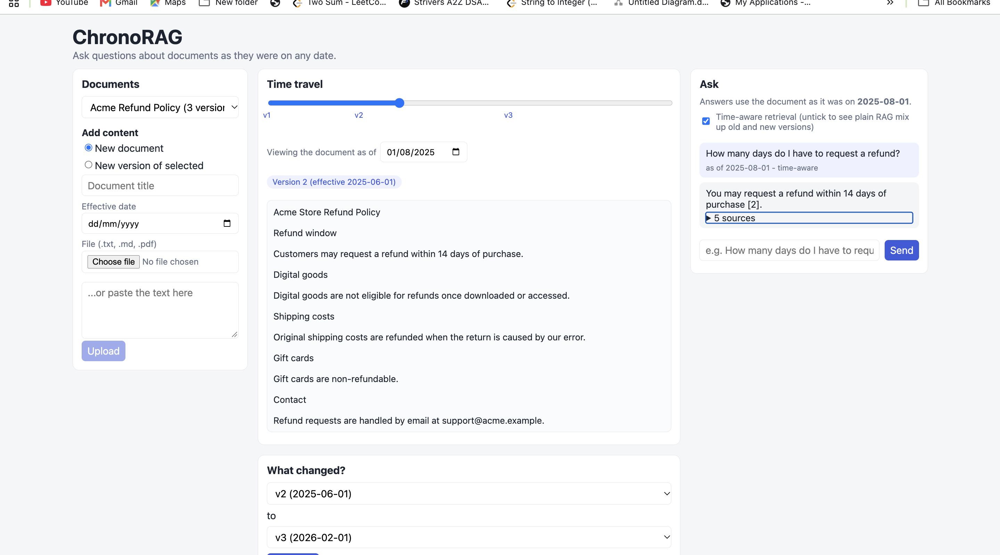
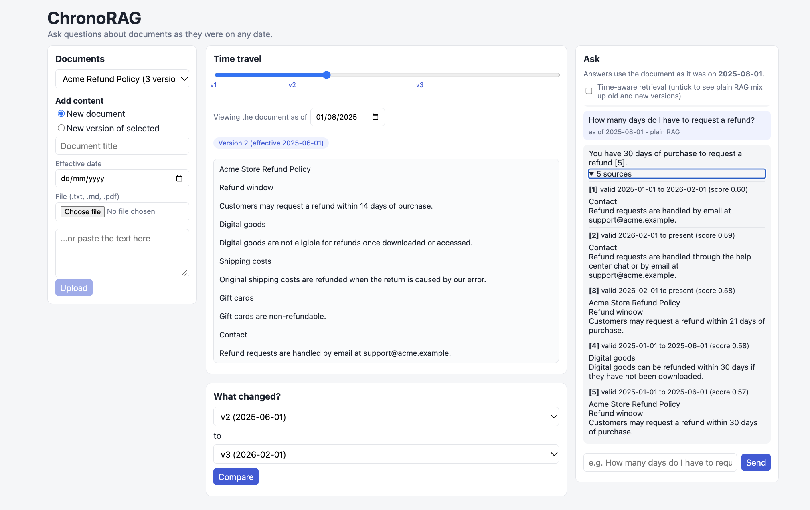
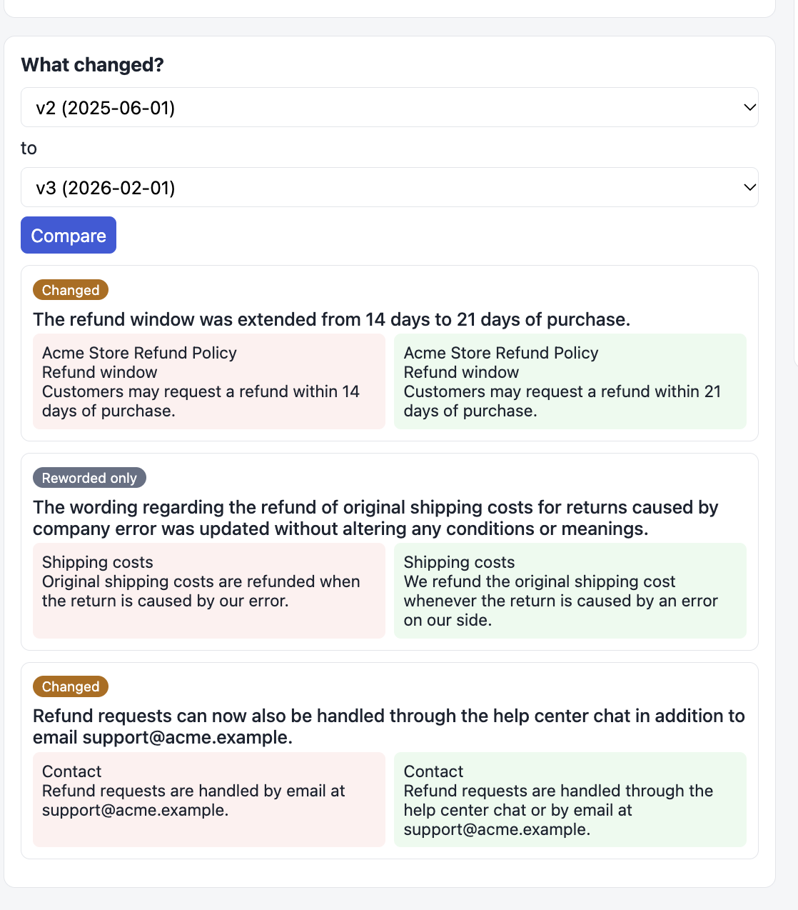

# ChronoRAG: "Git for knowledge" RAG

Most RAG demos answer questions from a pile of documents as if time did not exist. Real documents
(policies, terms of service, API docs, regulations) **change**, and a normal RAG system happily mixes
the old and new versions into one confused answer.

ChronoRAG treats every document like a repository with history:

- **Time-travel questions:** "What was the refund window on 1 March 2025?"
- **Semantic diff:** an LLM labels each change as *added*, *removed*, *changed* or *reworded only*
  (no real meaning change), and says exactly what changed.
- **Cheap versioning:** unchanged paragraphs are detected by content hash and are **not re-embedded**.
- **Built-in baseline:** a toggle switches to plain RAG so you can measure how much time-aware
  retrieval actually helps.

## Demo

Same question, same date (1 Aug 2025). The correct answer is 14 days.

**ChronoRAG (time-aware retrieval):** only the paragraphs valid on that date are searched.



**Plain RAG (baseline):** old and new versions get mixed together.



**Semantic diff:** each change is labelled as changed, added, removed or reworded only.



## Evaluation

I tested on two sets. Questions are in `eval/`, and `eval/run_eval.py` reproduces the numbers.

**1. Synthetic demo (7 questions, a made-up refund policy):** time-aware RAG 7/7, plain RAG 2/7.

**2. Real document (32 questions):** GitHub's public Terms of Service, loaded as 33 versions
from its Git history (2017 to 2021), using `scripts/ingest_git_history.py`.

| | Correct answers |
|---|---|
| ChronoRAG (time-aware retrieval) | 30 / 32 (94%) |
| Plain RAG (same model, no date filter) | 14 / 32 (44%) |

Each question is asked "as of" a date before or after a real change, and the right answer
differs between the two dates.

**Efficiency:** across the 33 versions, 337 paragraphs were embedded, compared with about
3,680 if every version were embedded from scratch (roughly 91% fewer), because unchanged
paragraphs are detected by content hash and reused.

**Limitations (please read):**
- One document, and the questions come from only 4 of its changes.
- I wrote the questions by hand after reading the diffs, so they are not independently validated.
- Scoring is a keyword check, with one run per question. LLM answers vary between runs.
- Version dates are Git commit dates, which can differ from the date a policy officially took effect.
- Both failures were questions asking for the title of a section. Pure semantic search can
  miss short headings. A planned fix is hybrid search (keyword plus vector).

## How it works

```
upload version -> split into paragraphs -> hash each paragraph
                     |
                     +-- hash already valid?  -> reuse chunk (no embedding cost)
                     +-- paragraph gone?      -> set valid_to = effective_date
                     +-- paragraph is new?    -> embed + insert with valid_from = effective_date

question + date -> embed question -> pgvector search WHERE valid_from <= date < valid_to
                -> top-k chunks -> LLM answers using ONLY those chunks, with citations
```

Every chunk has a validity interval `[valid_from, valid_to)`. `valid_to = NULL` means "still valid".
That one idea powers time travel, the timeline UI, and the evaluation baseline.

**Stack:** FastAPI, PostgreSQL + pgvector, sentence-transformers (local embeddings, free),
Gemini or Claude for generation, React + Vite.

## Project structure

```
chronorag/
  README.md
  .gitignore
  .env.example          copy to .env and add your key
  docker-compose.yml    Postgres with pgvector
  backend/
    requirements.txt
    pytest.ini
    app/
      main.py           API endpoints
      config.py         settings from .env
      db.py             connection + schema (documents, document_versions, chunks)
      chunking.py       paragraph-based chunking
      ingestion.py      versioning logic: reuse / close / insert chunks
      embeddings.py     local embedding model
      llm.py            Gemini / Anthropic wrapper
      diffing.py        semantic diff
    tests/              unit tests (no database or API key needed)
  frontend/
    package.json
    src/
      App.jsx
      api.js
      components/       UploadPanel, Timeline, DiffView, Chat
  sample_data/          three versions of a fake refund policy
  scripts/seed_demo.py  loads the sample data
  eval/                 questions.json + run_eval.py (time-aware vs plain RAG)
```

## Setup (Windows, macOS, Linux)

### 0. Install these once
- **Python 3.10 or newer** (3.11 recommended): https://www.python.org/downloads/ (on Windows tick "Add Python to PATH")
- **Node.js 18 or newer**: https://nodejs.org
- **Docker Desktop**: https://www.docker.com/products/docker-desktop (start it before step 2)
- **Git**: https://git-scm.com
- **VS Code** with the extensions *Python* and *ESLint* (optional)

### 1. Open the project in VS Code
`File > Open Folder...` and choose the `chronorag` folder. Open the built-in terminal with
**Ctrl + `** (Terminal > New Terminal).

### 2. Configure secrets
```bash
# Windows (PowerShell)
copy .env.example .env
# macOS / Linux
cp .env.example .env
```
Open `.env` and set `GEMINI_API_KEY` (free key: https://aistudio.google.com/apikey).
To use Claude instead, set `LLM_PROVIDER=anthropic` and `ANTHROPIC_API_KEY`.

### 3. Start the database
```bash
docker compose up -d
```
This starts Postgres with the pgvector extension on port **5433**.

### 4. Backend
```bash
cd backend

# create and activate a virtual environment
python -m venv .venv
# Windows (PowerShell):
.venv\Scripts\Activate.ps1
# macOS / Linux:
source .venv/bin/activate

pip install -r requirements.txt
uvicorn app.main:app --reload
```
- The first start downloads the embedding model (~90 MB) and can take a few minutes.
- Check http://localhost:8000/health and the auto-generated docs at http://localhost:8000/docs.
- In VS Code press **Ctrl+Shift+P > "Python: Select Interpreter"** and choose `backend/.venv`.

If PowerShell refuses to activate the venv, run once:
`Set-ExecutionPolicy -Scope CurrentUser RemoteSigned`

### 5. Load the demo data
Open a **second terminal** (keep the backend running):
```bash
cd backend
# activate the venv again (same command as above), then:
python ../scripts/seed_demo.py
```
You should see version 2 reusing chunks (`reused 2`) because only some paragraphs changed.

### 6. Frontend
Open a **third terminal**:
```bash
cd frontend
npm install
npm run dev
```
Open http://localhost:5173.

### 7. Try it
1. Drag the timeline slider: the document text changes with the date.
2. Under "What changed?" compare v1 and v2, then v2 and v3. The shipping paragraph in v3 should be labelled *reworded only*.
3. Ask "How many days do I have to request a refund?" with the date set to 2025-03-01, then 2025-08-01, then 2026-03-01.
4. Untick **Time-aware retrieval** and ask again to see plain RAG mix versions.

## Tests and evaluation

```bash
cd backend
python -m pytest            # chunking + diff tests, no database or API key needed
```

With the backend running and the demo data loaded:
```bash
python eval/run_eval.py
```
This compares time-aware RAG with the plain-RAG baseline on `eval/questions.json` and prints
pass rates. A question passes if the answer contains an expected phrase and no forbidden phrase.
That is a simple string check, so describe it honestly.

> The sample set has only 7 questions on one fake document. Before you put numbers on a resume, build a
> bigger set (30-40 questions) from **real** versioned documents and report those results.

## API summary

| Method | Path | Purpose |
|---|---|---|
| POST | `/documents` | Create a document with its first version (form: `title`, `effective_date`, `file` or `text`) |
| POST | `/documents/{id}/versions` | Add a newer version |
| GET | `/documents` | List documents and their versions |
| GET | `/documents/{id}/snapshot?as_of=YYYY-MM-DD` | Document text as of a date |
| GET | `/documents/{id}/diff?from_version=1&to_version=2` | Semantic diff |
| POST | `/query` | `{question, as_of, document_id, k, time_aware}` |
| DELETE | `/documents/{id}` | Delete a document |

## Push to GitHub

1. Create an empty repository on https://github.com/new (name it `chronorag`; do **not** add a README, .gitignore or licence there).
2. In the VS Code terminal, from the project root (`chronorag/`, not `backend/`):

```bash
git config --global user.name "Your Name"
git config --global user.email "you@example.com"

git init
git add .
git status                      # make sure .env and .venv are NOT listed
git commit -m "Initial commit: ChronoRAG"
git branch -M main
git remote add origin https://github.com/<your-username>/chronorag.git
git push -u origin main
```

GitHub will ask you to sign in (browser or a personal access token) the first time.
**Never commit `.env`.** It holds your API key; `.gitignore` already excludes it. If a key ever lands on
GitHub, revoke it immediately and create a new one.

For later changes: `git add .`, `git commit -m "describe the change"`, `git push`.

## Resume bullets (fill in YOUR real numbers)

- Built **ChronoRAG**, a version-aware RAG system (FastAPI, PostgreSQL/pgvector, React) that answers questions
  about documents as they read on any past date using validity-interval retrieval.
- Raised date-specific answer accuracy from **__%** (plain RAG) to **__%** on a **__**-question evaluation set.
- Cut re-embedding cost by **__%** on new document versions with paragraph-level content hashing.
- Implemented an LLM-assisted semantic diff that separates real changes from rewording-only edits
  (**__%** agreement with manual labels on **__** changes).

## Troubleshooting

| Problem | Fix |
|---|---|
| `connection refused` to Postgres | Start Docker Desktop, then `docker compose up -d`. Check `docker ps`. |
| `ModuleNotFoundError: app` | Run `uvicorn` from inside the `backend` folder. |
| `could not open extension control file ... vector` | You are not using the compose Postgres. Use `docker compose up -d` or install pgvector. |
| LLM errors / 429 | Missing key in `.env`, or free-tier rate limit. Wait, or use `python eval/run_eval.py --sleep 5`. |
| `404 model not found` from the LLM | Model names change. Update `GEMINI_MODEL` / `ANTHROPIC_MODEL` in `.env`. |
| Frontend shows "Cannot reach the backend" | Backend not running, or set `VITE_API_URL` in `frontend/.env`. |
| Port 5433 / 8000 / 5173 already in use | Change the port in `docker-compose.yml`, the `uvicorn --port` flag, or `vite.config.js`. |
| Re-seeding | `docker compose down -v` wipes the database; then start again. |

## Known limitations and ideas for next steps

- Versions must be added in date order (no back-dating).
- Scanned PDFs are not supported (add OCR with Tesseract).
- Paragraph chunking works best for structured text; PDFs without blank lines fall back to sentence splitting.
- Add a vector index (HNSW) once you have many chunks, and test it together with the date filter.
- Add hybrid search (keyword + vector) and a reranker, then measure the difference.
- Cross-document contradiction alerts when a new version conflicts with another document.
- User accounts, streaming answers, Docker deployment, hosted deployment (Vercel + Render/Railway + Neon/Supabase).
